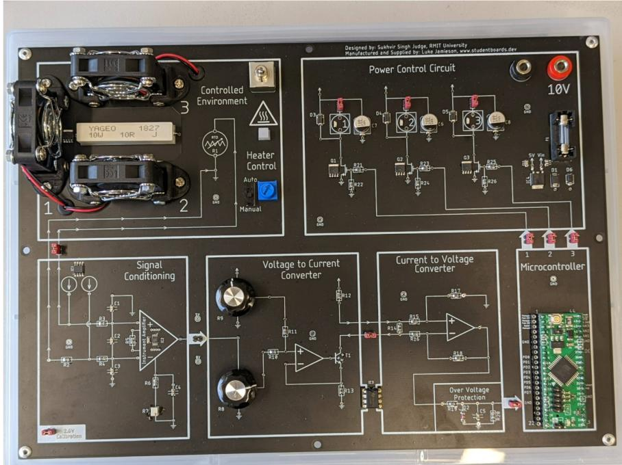
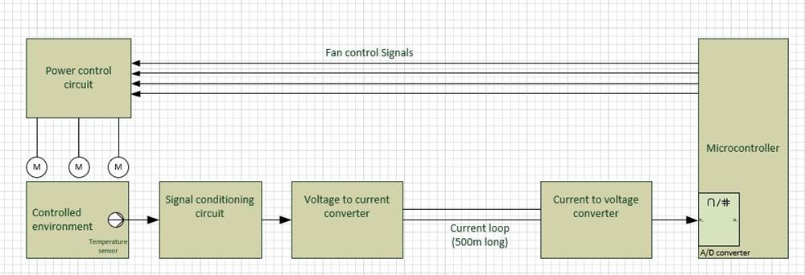
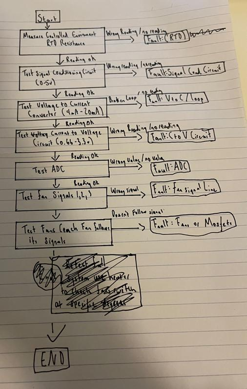
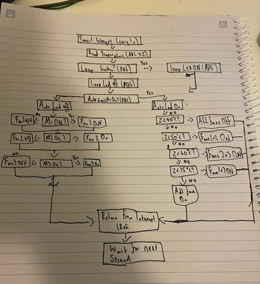

# ATmega32 Fan Controller: Troubleshooting & Upgrade (AVR Assembly)

Fault-finding and upgrading a microcontroller-based temperature control system. An RTD sensor feeds a 4–20 mA current loop into an **ATmega32**, which switches three cooling fans. I traced the signal path block by block to find a hardware fault, then rewrote the **AVR assembly** firmware to meet a customer's new requirements.

Completed for *UEEEC0072 Troubleshoot microcontroller-based hardware systems* (Advanced Diploma of Electronics and Communications Engineering, RMIT, 2026).



*Fault-finding training board designed by Sukhvir Singh Judge (RMIT) and manufactured by Luke Jamieson.*

## The system



| Block | What it does |
|---|---|
| **RTD sensor** | Resistance rises linearly with temperature, from 100 Ω at 0 °C to about 138.5 Ω at 100 °C |
| **Signal conditioning** | An instrumentation amplifier compares the RTD with a 100 Ω reference and gives 0–5 V for 0–100 °C |
| **Voltage-to-current converter** | Converts 0–5 V to a **4–20 mA current loop**, which is noise-resistant over a long (500 m) cable |
| **Current-to-voltage converter** | Converts the loop back to 0.66–3.3 V for the microcontroller |
| **ATmega32 ADC** | A 10-bit reading (0–1023), taken once a second from a Timer1 interrupt |
| **Power control** | MOSFETs switch the three fans, with diodes protecting against inductive spikes |

## Part 1: Finding the fault

I followed the signal from the sensor to the fans, one block at a time. A correct reading ruled a block out, and the first wrong reading showed where the fault was.



### Measurements (Table A)

| RTD | Signal conditioning out | Loop current | ADC input | Fan 1 | Fan 2 | Fan 3 |
|---|---|---|---|---|---|---|
| 111.6 Ω | 1.46 V | 8.48 mA | 1.39 V | OFF | OFF | OFF |
| 116.3 Ω | 1.98 V | 10.02 mA | 1.64 V | ON | OFF | OFF |
| 125.2 Ω | 2.90 V | 12.7 mA | 2.02 V | ON | ON | OFF |
| 133.3 Ω | 4.06 V | 16.3 mA | 2.52 V | ON | ON | ON |

### Result

- The RTD and the signal conditioning stage both read correctly.
- At the voltage-to-current converter, the loop measured **0 mA** instead of 4–20 mA, which is a **broken current loop**.
- Every block after that point failed as well, which confirmed where the fault was. My assessor confirmed it.
- I calibrated the V→I converter by injecting 0 V and 5 V and trimming its potentiometers to give 0.66 V and 3.3 V at the output.

**Tools used:** multimeter (in series for loop current), DC bench supply, jumper wires, expected-values table, and software breakpoints in Microchip Studio to read the ADC value.

## Part 2: Firmware upgrade

The customer reported that Fan 1 was almost always on and Fan 3 almost never was. They wanted all three fans to share the load, plus a manual override.

### New automatic fan table

| Temperature | ADC threshold | Fan 1 | Fan 2 | Fan 3 |
|---|---|---|---|---|
| below 40 °C | < `$019A` (410) | OFF | OFF | OFF |
| 40–50 °C | `$019A` (410) | ON | ON | OFF |
| 50–60 °C | `$0200` (512) | OFF | ON | ON |
| 60–75 °C | `$0260` (608) | ON | OFF | ON |
| above 75 °C | `$0300` (768) | ON | ON | ON |

### Features added

- **Auto/Manual switch (PA1):** in Auto mode the table above is used. In Manual mode, the switches M1/M2/M3 (PA2–PA4) turn each fan on or off directly.
- **Auto annunciator LED (PB3):** lit whenever the system is in Auto mode.
- **Broken current loop annunciator (PA6 → PB6):** a fault LED, so the fault I found in Part 1 shows up straight away next time.
- **Subroutines:** the code is split into `Read_ADC`, `Check_Loop`, `Auto_Mode` and `Manual_Mode`, all called from the 1-second Timer1 interrupt.



### How the code works ([`src/main.asm`](src/main.asm))

**Timer1 interrupt (every 1 s):** read the temperature, check the loop, then branch on the Auto switch.

```asm
Control_routine:
        call Read_ADC           ; subroutine: read temperature into Z
        call Check_Loop         ; subroutine: current loop broken annunciator

        sbic PINA, AUTO_SW      ; Auto switch OFF (0)? -> skip next
        call Auto_Mode          ;   Auto ON  -> automatic fan table
        sbis PINA, AUTO_SW      ; Auto switch ON (1)? -> skip next
        call Manual_Mode        ; Auto OFF -> manual M1/M2/M3

        reti                    ; return from interrupt
```

**Auto mode:** a 16-bit compare of the ADC result (Z) against each threshold (X), from lowest to highest. The first threshold the reading is below picks the fan pattern.

```asm
        ldi XL, $9A             ; X = $019A (40C)
        ldi XH, $01
        cp  ZL, XL              ; compare low bytes
        cpc ZH, XH              ; compare high bytes (with carry)
        brlo All_Off            ; below 40C -> all fans off

        ldi XL, $00             ; X = $0200 (50C)
        ldi XH, $02
        cp  ZL, XL
        cpc ZH, XH
        brlo Fan_12             ; 40-50C -> fans 1 + 2
        ...
```

**Timer setup:** Timer1 in CTC mode with a prescaler of 256 and OCR1A = `$7A12` (31,250) gives an interrupt every 1 second.

```asm
    ldi temp, $7A               ; OCR1A = $7A12 = 31250 - write high byte first
    out OCR1AH, temp
    ldi temp, $12
    out OCR1AL, temp
    ldi temp, $10               ; OCIE1A = 1 - allow compare match A interrupt
    out TIMSK, temp
    ldi temp, $0C               ; CTC mode, prescaler 256
    out TCCR1B, temp
```

### Testing

I tested every new feature in the Microchip Studio simulator, using breakpoints and by setting register values by hand:

| Test | Input | Result |
|---|---|---|
| Broken loop | PINA = `0x40` (PA6 high) | PORTB = `0x40`: loop LED on |
| Auto mode | PINA = `0x02` (PA1 high) | PB3 Auto LED on |
| Manual M1 | PINA = `0x04` (PA2 high, Auto off) | PORTB = `0x01`: Fan 1 on |
| Above 75 °C | Z = `0x0350` | PORTB = `0x0F`: all fans + Auto LED on |
| Each band | Z = `0x01C0`, `0x0230`, `0x02A0` | Correct fan pattern for 40–50, 50–60 and 60–75 °C |

## Files

| Path | Contents |
|---|---|
| `src/main.asm` | The modified AVR assembly program for the ATmega32 |
| `src/FanController.asmproj` | Microchip Studio project file |
| `docs/` | Training board photo, block diagram, schematic, both flowcharts |

## What I learned

- Systematic, block-by-block fault finding: following the signal path and comparing each reading with the expected value.
- How 4–20 mA current loops work, and why a 0 mA reading means a broken loop and not a low reading.
- Calibrating analogue stages with test inputs and trim pots.
- AVR assembly: I/O port setup, the ADC, Timer1 CTC interrupts, 16-bit compares with `cp`/`cpc`, and structuring code into subroutines.
- Debugging firmware with breakpoints and register inspection before testing on live hardware.
